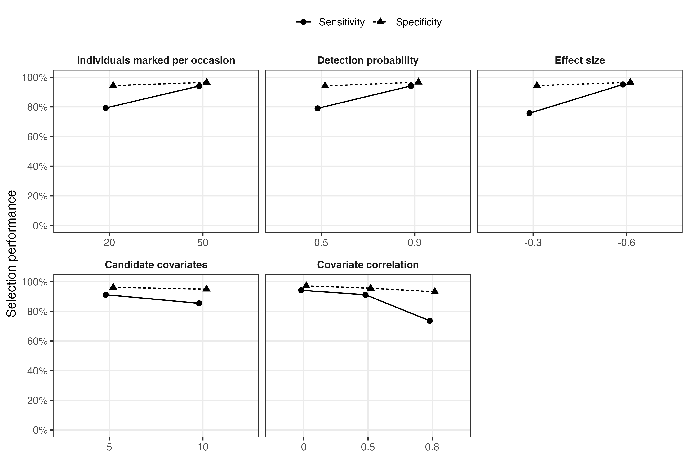
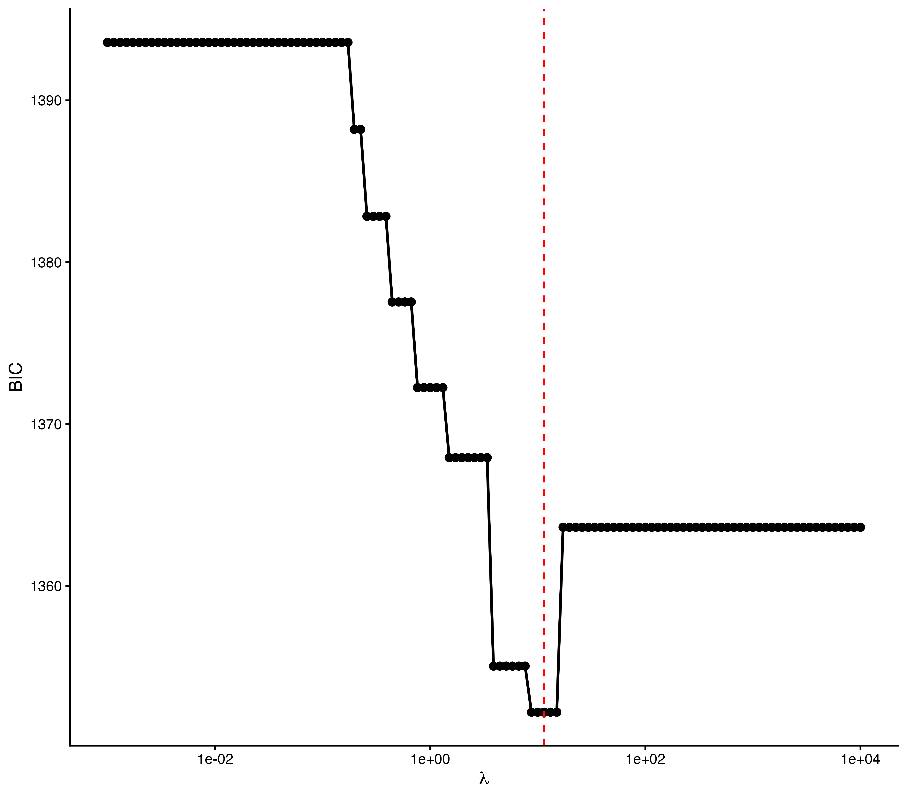
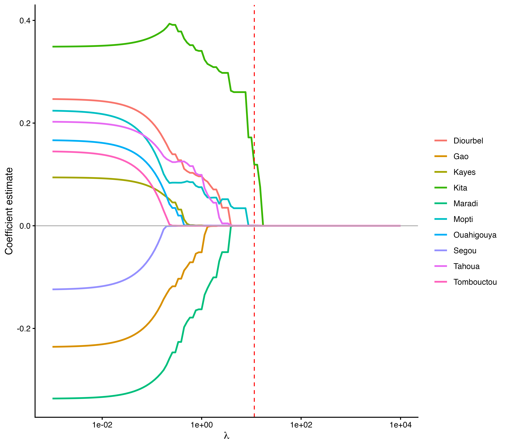

\small

^1^ CEFE, Univ Montpellier, CNRS, EPHE, IRD, Montpellier, France   

^2^ School of Information and Physical Sciences, College of Engineering, Science and Environment, University of Newcastle, Newcastle, Australia     

`*` Corresponding author: olivier.gimenez@cefe.cnrs.fr

\normalsize

\vspace{1cm}
\hrule

Explaining temporal variation in demographic parameters (e.g. survival, dispersal) is a central goal of capture-recapture (CR) studies, and the growing availability of environmental covariates means analysts increasingly face many, often correlated, candidate covariates. Standard covariate-selection tools become impractical as the number of candidates grows, since the number of candidate models increases combinatorially. We propose to use the Lasso, a penalized-likelihood approach that shrinks regression coefficients and sets some of them to zero, to perform automatic covariate selection in CR models. We implemented an adaptive Lasso applied to the likelihood of Cormack-Jolly-Seber (CJS) models, with the regularization parameter selected by BIC or AIC along a grid of penalty values. To assess performance, we carried out a simulation study spanning a range of sample sizes, detection probabilities, effect sizes, numbers of covariates and correlation structures. Selection performance improved with more marked individuals, higher detection probabilities and larger effect magnitudes, and deteriorated as the number of candidate covariates and their correlation increased. The adaptive Lasso combined with BIC generally behaved conservatively, rarely retaining irrelevant covariates but sometimes missing genuine effects. Using AIC instead of BIC improved the detection of relevant effects but at the cost of more false positives and a lower probability of recovering the true set of covariates. We illustrated the approach with a 16-year CR dataset on white storks (*Ciconia ciconia*) breeding in France, in which survival was modelled as a function of rainfall at 10 weather stations in the wintering grounds (Sahel, West Africa). The adaptive Lasso offers a promising alternative to conventional model selection, making the investigation of environmental correlates of demographic variation more tractable as the number of candidate covariates and the complexity of CR models increase.

\vspace{3mm}
\hrule
\vspace{5mm}

*Keywords*: capture-recapture; covariate selection; Lasso; penalized likelihood; survival analysis; regularization

\newpage

```{r setup, include=FALSE, cache=FALSE, message = FALSE}
library("knitr")
opts_chunk$set(echo = FALSE, warning = TRUE, message = TRUE)
opts_chunk$set(tidy = TRUE, comment = NA, highlight = TRUE)
opts_chunk$set(fig.path = "output/figures/")
```

# Introduction

Explaining variation in demographic parameters such as survival or dispersal is a central objective of statistical ecology [@gimenez2014]. Capture-recapture (CR) methods are the standard tool for this task. Individuals are captured, marked and (imperfectly) re-observed over time, and demographic parameters are estimated while explicitly accounting for detection probability [@Lebreton1992]. To relate demographic parameters to environmental or individual covariates, CR modelling is typically framed as a form of generalized linear model, in which the temporal or individual variation in parameters is explained by one or several covariates on the logit scale [@Lebreton1992].

This regression-like framing runs into a practical difficulty as soon as the number of candidate covariates grows. This situation has become the norm rather than the exception with the increasing availability of environmental data from remote sensing and biologging. Ecologists are then confronted with many, often correlated, candidate covariates, and typically do not know a priori which of them belong in the model. Including all of them inflates the number of parameters to estimate, which may degrade precision and predictive performance, while strong correlation among covariates may further destabilizes numerical estimation.

Several strategies exist to select covariates in CR models. Ecologists commonly reduce the covariate set a priori based on ecological reasoning and collinearity diagnostics, then compare a set of candidate models using information criteria such as AIC, or a stepwise procedure [@burnham2002]; Bayesian alternatives include DIC, stochastic search variable selection (SSVS) or reversible-jump MCMC (RJMCMC) [@tredennick2021; @hooten2015]. The underlying model space, however, grows rapidly with the number of candidate covariates ($2^K$ models for $K$ covariates), making exhaustive model comparison impractical. This number multiplies further in CR models with several linked parameter sets (survival, detection and transition probabilities) because each parameter set may have its own combination of candidate covariates.

Here we explore an alternative route. Instead of comparing candidate models, we cast covariate selection as a shrinkage problem. Penalized-likelihood methods add a penalty on the magnitude of regression coefficients to the likelihood being maximized; the Lasso for Least Absolute Shrinkage and Selection Operator [@tibshilasso] uses an $L_1$ penalty that has the property of setting some coefficient estimates exactly to zero, thereby performing covariate selection and shrinkage simultaneously. Penalized-likelihood approaches related to the Lasso have been used in ecology, notably for occupancy models [@hutchinson2015; @clipp2021]. However, to our knowledge, they have not yet been applied to covariate selection in CR models. Here, we address this gap.

In this paper, we apply the adaptive Lasso to the likelihood of Cormack-Jolly-Seber (CJS) CR models to perform automatic selection of covariates on survival. We describe the method, evaluate its performance through a simulation study spanning a range of sample sizes, detection probabilities, numbers of covariates and correlation structures, compare the performance of AIC and BIC for selecting models along the regularization path, and illustrate it with a case study on the effect of Sahelian rainfall on the survival of white storks (*Ciconia ciconia*) breeding in France. We conclude with current limitations and extensions.

# Methods {#methods}

## Capture-recapture likelihood

Consider a CJS model for $n$ individually marked animals monitored over $T$ capture occasions. Let $\phi_t$ denote the probability that an individual alive just after occasion $t$ survives to occasion $t+1$, and $p_t$ the probability that an individual alive at occasion $t$ is detected. Survival is related to a set of $K$ covariates through a logit link,
$$
\text{logit}(\phi_t) = \mathbf{x}_t^\top \boldsymbol{\beta},
$$
where $\mathbf{x}_t$ is the covariate vector (including an intercept) associated with interval $t$ and $\boldsymbol{\beta} = (\beta_0, \beta_1, \ldots, \beta_K)^\top$ the corresponding regression coefficients; detection is modelled separately (e.g. constant, or with its own covariates), and only the survival regression coefficients are subject to penalization in our approach. The CJS likelihood is formulated as a hidden Markov model conditional on first capture [@pradel2005multievent]. The hidden states correspond to the alive and dead states, while the observations correspond to detection or non-detection. The likelihood is evaluated efficiently using the forward algorithm.

## Ridge regression and the Lasso

Ridge regression constrains the $L_2$ norm, $\sum_{j=1}^K \beta_j^2 \le c$, shrinking coefficients towards zero but rarely to exactly zero. The Lasso instead constrains the $L_1$ norm, $\sum_{j=1}^K |\beta_j| \le c$. In both approaches, the intercept is left unpenalized. Geometrically, the $L_1$ constraint region has sharp corners, so that the point where the likelihood contours first touch the constraint region often falls exactly on a corner or edge, setting the corresponding coefficient(s) to zero. This sparsity property makes the Lasso a method for simultaneous estimation and covariate selection. 

It is convenient to rewrite the constrained optimization problem in its Lagrangian form. The adaptive Lasso extends the standard Lasso by assigning different penalty weights to individual regression coefficients. For a penalty parameter $\lambda \ge 0$, the adaptive Lasso estimator maximizes

$$
\ell(\boldsymbol{\beta}) -
\lambda \sum_{j=1}^{K} w_j |\beta_j|,
$$

where the adaptive weights are defined as

$$
w_j=\frac{1}{
\left(\max\{|\hat{\beta}^{\mathrm{MLE}}_j|,\epsilon\}\right)^\gamma
},
$$

where $\ell(\boldsymbol{\beta})$ is the likelihood function, $\hat{\beta}^{\mathrm{MLE}}_j$ denotes the unpenalized maximum-likelihood estimate from the full model and $\gamma>0$ controls the strength of the adaptation. The small positive constant \(\epsilon\) prevents division by zero and limits the magnitude of the adaptive weights when the unpenalized coefficient estimates are close to zero. Throughout this study, we set $\gamma=1$ and $\epsilon=10^{-6}$. Covariates with larger unpenalized effects therefore receive a smaller penalty, whereas those with weaker effects are penalized more heavily. Under suitable regularity conditions, including a consistent initial estimator and a penalty parameter that balances the estimation of nonzero coefficients with the elimination of zero coefficients as sample size increases, the adaptive Lasso enjoys the oracle property: consistent identification of nonzero coefficients and asymptotically efficient estimation of their values [@Zou2006]. While these theoretical guarantees do not automatically extend to CJS models, they provide a motivation for investigating the performance of the adaptive Lasso in CR settings.

## Choice of the regularization parameter

The amount of shrinkage is controlled by the regularization parameter $\lambda$. We evaluate a sequence of 120 values logarithmically spaced between $10^{-3}$ and $10^4$. We assessed the adequacy of the grid by checking whether all candidate covariates were retained at its lower bound and none at its upper bound. The grid is explored in increasing order of $\lambda$, using the estimates obtained at the preceding penalty value as starting values for the next optimization (warm starts). For each value of $\lambda$, the adaptive Lasso optimization identifies a set of nonzero regression coefficients defining the corresponding candidate model. A penalized regression coefficient is considered equal to zero whenever its absolute value is smaller than or equal to $10^{-3}$.

Rather than comparing penalized estimates directly, we adopt a post-Lasso (also called relaxed Lasso) refit strategy. For each distinct support identified along the regularization path, the CJS model is refitted by maximum likelihood without penalization while retaining only the covariates selected by the adaptive Lasso. Information criteria are then computed from this unpenalized refit rather than from the penalized estimates. This approach removes the direct effect of penalization on coefficient estimates while allowing candidate models to be compared using a common likelihood scale [@Meinshausen2007; @Belloni2013]. More generally, this strategy separates variable selection from parameter estimation: the adaptive Lasso is used to identify a parsimonious set of covariates, whereas parameter estimation and model comparison rely on unpenalized maximum-likelihood estimates obtained from the selected model.

The retained model is selected by minimizing the Bayesian Information Criterion (BIC)

$$
\mathrm{BIC}
=
-2\,\ell(\hat{\boldsymbol{\beta}})
+
df \log(n),
$$
or the Akaike Information Criterion (AIC)

$$
\mathrm{AIC}=-2\,\ell(\hat{\boldsymbol{\beta}}) + 2df,
$$

where $\ell(\hat{\boldsymbol{\beta}})$ is the maximized log-likelihood of the unpenalized refitted model and $df$ is the total number of estimated parameters in the refitted model (including both selected regression coefficients and unpenalized parameters).

We prefer this information-criterion-based grid-search strategy to $k$-fold cross-validation which would require refitting the entire regularization path for every fold, substantially increasing the computational cost. 


## Implementation

The CJS likelihood, the adaptive-Lasso path and the information-criterion-based selection are implemented in `R`. The CJS likelihood is evaluated in `C++` and interfaced with `R` using the `Rcpp` [@rcpp] and `RcppArmadillo` [@rcpparmadillo] packages. Both unpenalized and penalized likelihoods are optimized using the BFGS algorithm implemented in the `R` function `optim()`. To improve the robustness of the initial unpenalized fit, which determines the adaptive weights, we use ten different starting points and retain the solution with the highest likelihood. Subsequent penalized fits are initialized using warm starts along the regularization path.

To improve numerical stability, we use the intercept-only model as a benchmark, since it is a feasible solution for any penalty value. If a penalized fit yields a non-finite or worse objective function value (beyond a numerical tolerance), optimization is restarted from the intercept-only estimates. If no solution at least as good as the benchmark is found, the intercept-only solution is retained.

# Simulation study {#simulations}

To evaluate the ability of the adaptive Lasso to identify the true survival covariates under a range of realistic capture-recapture settings, we conducted a simulation study.

## Design

We simulated capture-recapture data under the CJS model with 20 capture occasions and either 20 or 50 newly marked individuals per occasion. Mean survival probability was fixed at $\bar{\phi}=0.8$, whereas detection probability was constant over time and took values of 0.5 or 0.9. Survival was modelled as a function of either 5 or 10 candidate covariates. In every scenario, only two covariates had a genuine effect on survival, with regression coefficients both set to either $-0.3$ or $-0.6$ on the logit scale, while all remaining coefficients were equal to zero. This design allowed us to examine how covariate-selection performance changed as the number of candidate predictors increased while the number of truly informative predictors remained fixed. Covariates were generated either independently or with a pairwise correlation of 0.5 or 0.8, representing increasingly challenging conditions for covariate selection.

The full factorial design comprised 48 scenarios. Each scenario was replicated 100 times, resulting in a total of 4800 simulated data sets. 

## Performance metrics

Our primary performance metric was the exact selection probability, defined as the proportion of simulation replicates in which the adaptive Lasso recovered exactly the true set of active covariates. We also calculated sensitivity (the proportion of active covariates correctly retained) and specificity (the proportion of inactive covariates correctly excluded). For each replicate, we recorded the numbers of true positives, false positives and false negatives, as well as the total number of selected covariates.

To assess numerical performance, we monitored convergence of the initial and final unpenalized fits and of the penalized fits along the regularization path, accounting for intercept-only fallback solutions. We also recorded computation time to assess how computational cost varied with the number of candidate covariates.

To assess the influence of the simulation factors on selection performance, we fitted a binomial generalized linear model for exact selection and quasibinomial generalized linear models for sensitivity and specificity. All simulation factors were included jointly as categorical predictors. For each factor, we obtained marginal predictions and associated 95% confidence intervals, averaging over the levels of the remaining factors. We compared BIC and AIC by summarizing selection performance across all simulation replicates.

## Results

All 4,800 simulation replicates were completed without computational errors. The initial and final unpenalized fits converged in all replicates, and all penalized fits either converged according to the optimizer or were assigned the intercept-only fallback solution. The upper bound of the regularization grid always yielded the intercept-only model, whereas all candidate covariates were retained at its lower bound in 85.2% of replicates. 

The probability of recovering the exact set of active covariates increased with the number of individuals marked per occasion, detection probability, and covariate effect magnitude. Conversely, exact selection became less likely as the number of candidate covariates and the correlation among them increased (Fig. \@ref(fig:exact-selection)). These adjusted effects were estimated jointly, so the influence of each simulation factor was evaluated while averaging over the balanced levels of all remaining factors. 

```{r exact-selection, out.width="100%", fig.align='center', fig.cap="Adjusted probability of exact model selection using adaptive Lasso with BIC. Points are estimated marginal probabilities from a binomial generalized linear model, adjusted for the other simulation factors; vertical bars are 95% confidence intervals.", eval=TRUE}
include_graphics("figure_exact_selection_adjusted.png")
```

The adaptive Lasso tuned using BIC generally behaved conservatively. Specificity remained high across the simulation design, indicating that inactive covariates were rarely retained, whereas sensitivity was more strongly affected by the amount of information in the data (Fig. \@ref(fig:senspec)). Thus, under difficult sampling conditions, failures of exact model recovery were driven more often by omission of active covariates than by extensive inclusion of inactive covariates. Increasing correlation among covariates led to both more false negatives and more false positives, particularly when genuine effects were weak.

```{r senspec, out.width="100%", fig.align='center', fig.cap="Adjusted sensitivity and specificity of adaptive-Lasso selection using BIC. Estimates are marginal predictions from quasibinomial generalized linear models, adjusted for the other simulation factors; vertical bars are 95% confidence intervals.", eval=TRUE}

```

```{r echo = FALSE, message = FALSE, warning = FALSE}
library(tidyverse)
library(emmeans)

bic_file <- "~/Dropbox/OG/GITHUB/crlasso/code/simulations/BIC/scenario_grid_results_BIC.csv"
aic_file <- "~/Dropbox/OG/GITHUB/crlasso/code/simulations/AIC/scenario_grid_results_AIC.csv"

read_results <- function(path, expected_criterion) {
  
  out <- read.csv(
    path,
    check.names = FALSE,
    stringsAsFactors = FALSE
  )
  
  required <- c(
    "scenario_id", "replicate", "n_occasions",
    "marked", "p", "effect_size",
    "n_covariates", "correlation",
    "exact_selection", "n_selected",
    "true_positives", "false_positives",
    "false_negatives", "true_negatives",
    "sensitivity", "specificity", "convergence"
  )
  
  absent <- setdiff(required, names(out))
  
  out |>
    mutate(
      occasions = factor(n_occasions, levels = 20),
      individuals = factor(marked, levels = c(20, 50)),
      detectability = factor(p, levels = c(0.5, 0.9)),
      effect = factor(effect_size, levels = c(-0.3, -0.6)),
      candidates = factor(n_covariates, levels = c(5, 10)),
      correlation_factor = factor(
        correlation,
        levels = c(0, 0.5, 0.8)
      )
    )
}

bic <- read_results(bic_file, "BIC")
aic <- read_results(aic_file, "AIC")
```

Across all simulation scenarios, BIC recovered the exact model in `r sprintf("%.1f", 100 * mean(bic$exact_selection, na.rm = TRUE))`% of datasets, with mean sensitivity `r sprintf("%.3f", mean(bic$sensitivity, na.rm = TRUE))`, mean specificity `r sprintf("%.3f", mean(bic$specificity, na.rm = TRUE))`, and a mean selected model size of `r sprintf("%.2f", mean(bic$n_selected, na.rm = TRUE))` covariates. The corresponding values under AIC were `r sprintf("%.1f", 100 * mean(aic$exact_selection, na.rm = TRUE))`%, `r sprintf("%.3f", mean(aic$sensitivity, na.rm = TRUE))`, `r sprintf("%.3f", mean(aic$specificity, na.rm = TRUE))`, and `r sprintf("%.2f", mean(aic$n_selected, na.rm = TRUE))`, respectively. On average, using AIC instead of BIC led to the inclusion of 0.16 additional active covariates but also 0.78 additional inactive covariates per simulated dataset.

AIC therefore increased sensitivity relative to BIC but reduced specificity and selected larger models. Under the conditions investigated, BIC therefore offered a better compromise when the objective was to recover the true set of active covariates.

The median computation time per regularization path, including unpenalized refitting, was 1.94 seconds, increasing from 1.32 seconds with five candidate covariates to 2.65 seconds with ten.

# Case study: white stork survival and Sahelian rainfall {#case-study}

We illustrate the proposed methodology using a long-term capture-recapture study of white storks (*Ciconia ciconia*) breeding in France [@grosbois2008assessing]. The data span 16 years and include more than 200 individually marked adults.

Most French white storks winter in the Sahel, where annual rainfall strongly influences primary productivity and food availability. Previous studies have therefore suggested that climatic conditions in the Sahel may affect annual adult survival. To investigate this hypothesis, we considered annual rainfall measured at ten meteorological stations distributed across the Sahel as candidate covariates for survival. Pairwise Pearson correlations among the ten covariates ranged from -0.32 to 0.62. Detection probability was modelled with an intercept only.

We fitted the full survival model including all ten rainfall covariates and computed the adaptive Lasso solution path over the regularization grid described above. The optimal model was selected using the BIC computed from unpenalized refits of the candidate models identified along the path.

The BIC reached its minimum for a penalty value of approximately $\lambda = 11.4$ (Fig. \@ref(fig:bic-path)). The regularization parameter is shown on a logarithmic scale. Several penalty values may correspond to the same selected model and therefore yield identical BIC values.

```{r bic-path, out.width="100%", fig.align='center', fig.cap="Bayesian Information Criterion as a function of the regularization parameter $\\lambda$ for the white stork survival model. The horizontal axis is displayed on a logarithmic scale. The vertical dashed line indicates a value of $\\lambda$ yielding the minimum BIC.", eval=TRUE}

```

The coefficient paths (Fig. \@ref(fig:coef-path)) show the progressive shrinkage of the rainfall effects as the penalty increases. The regularization parameter is displayed on a logarithmic scale.

```{r coef-path, out.width="100%", fig.align='center', fig.cap="Regularization paths for the ten rainfall coefficients as a function of the penalty parameter $\\lambda$. The horizontal axis is displayed on a logarithmic scale. The vertical dashed line indicates the value of $\\lambda$ selected by the Bayesian Information Criterion.", eval=TRUE}

```

At the selected value of $\lambda$, only one rainfall covariate, corresponding to the meteorological station of Kita, retained a nonzero coefficient, whereas the remaining nine coefficients were classified as zero (Table \@ref(tab:coef-table)). The estimated effect of rainfall at Kita was positive, indicating higher apparent survival in wetter years. This result agrees with earlier analyses of these data, which identified the same geographical region as the main climatic driver of survival after reducing the rainfall variables by principal component analysis [@grosbois2008assessing].

```{r coef-table, echo=FALSE}
knitr::kable(
  data.frame(
    Parameter = c(
      "Survival intercept",
      "Diourbel",
      "Gao",
      "Kayes",
      "Kita",
      "Maradi",
      "Mopti",
      "Ouahigouya",
      "Segou",
      "Tahoua",
      "Tombouctou",
      "Detection intercept"
    ),
    Estimate = c(
      0.6812167,
      0.0000000,
      0.0000000,
      0.0000000,
      0.3572071,
      0.0000000,
      0.0000000,
      0.0000000,
      0.0000000,
      0.0000000,
      0.0000000,
      2.3695514
    ),
    Selected = c(
      "Yes",
      "No",
      "No",
      "No",
      "Yes",
      "No",
      "No",
      "No",
      "No",
      "No",
      "No",
      "Yes"
    )
  ),
  digits = 4,
  booktabs = TRUE,
  caption = "Adaptive Lasso estimates for the white stork case study. Only the rainfall covariate corresponding to the Kita meteorological station was retained by the BIC-selected model."
)
```

# Discussion {#discussion}

We have shown that the adaptive Lasso can be applied directly to the CJS likelihood to perform covariate selection in CR survival models. This approach provides a framework for identifying environmental drivers of demographic variation while accounting for imperfect detection, without explicitly enumerating the entire set of candidate models. Our simulations highlighted the importance of the choice of information criterion, sampling design, and covariate characteristics for successful covariate selection.

The choice of information criterion for selecting models along the regularization path influenced covariate-selection performance. Compared with BIC, AIC increased the probability of retaining active covariates but also increased the probability of retaining inactive ones. In our simulations, the gains in sensitivity achieved by AIC were modest relative to the increase in the number of false positives. Consequently, despite its higher sensitivity, AIC was less successful than BIC at recovering the exact set of active covariates. The choice between these criteria should therefore reflect the objectives of the analysis and the relative consequences of false-positive and false-negative selections. BIC may be preferable when identifying a parsimonious set of predictors is the primary objective, whereas AIC may be useful when overlooking potentially relevant covariates is of greater concern. 

Our results highlight the importance of sampling design for the identification of environmental drivers of demographic variation. The probability of recovering the true set of covariates increased with both the number of newly marked individuals and detection probability. The ability to identify ecological relationships depends not only on the magnitude of the underlying effects but also on the amount of information available to estimate demographic parameters while accounting for imperfect detection [@grosbois2008assessing]. For purely temporal covariates, however, increasing the number of marked individuals does not increase the number of independent temporal contrasts available to estimate covariate effects [@frederiksen2014]. Increasing sampling effort and extending the duration of monitoring programmes may therefore play complementary roles in improving covariate selection.

A key advantage of working directly at the likelihood level is that the approach could be extended to CR models with several linked sets of parameters; for instance multistate models (survival, detection, transition probabilities) or multievent models with additional latent-state parameters [@gimenezBayesianAnalysisCapturerecapture2026]. In such models, conventional stepwise model selection is cumbersome because of the large number of candidate models and the dependence of selection outcomes on the order in which parameter sets are considered. Penalized likelihood offers a way to address this problem by jointly selecting covariates across parameter sets, using parameter-specific penalty strengths. How to tune these penalties efficiently remains an avenue for future research.

Several limitations remain. First, covariate correlation was an important determinant of selection performance. Under strong collinearity, the adaptive Lasso was less successful at recovering the true set of active covariates, with both false-positive and false-negative selections. Penalized variable selection therefore does not remove the need for ecological reasoning and careful examination of covariate dependence. The elastic net [@elasticnet], which combines \(L_1\) and \(L_2\) penalties, may be useful in such situations, although whether its tendency to retain correlated predictors improves the recovery of active covariates remains an open question. Second, we focused on continuous temporal covariates. For categorical covariates (e.g. age class or discrete time effects), interest often lies in the effect of the factor as a whole rather than that of individual levels. The group Lasso [@yuan2006model], which penalizes and selects groups of coefficients jointly, is a natural extension that we are currently exploring. Third, our general-purpose optimization routine requires a numerical threshold to identify zero coefficients and does not guarantee optimal solutions along the entire regularization path. Although the intercept-only model was recovered in all simulation replicates, the full model was not always recovered at the lower bound of the regularization grid. This may reflect residual shrinkage, numerical thresholding or optimization limitations. Dedicated algorithms for non-smooth optimization, such as proximal-gradient methods, could improve the accuracy and computational efficiency of the approach. 

<!-- Finally, our study focused on covariate selection rather than on inference about the magnitude of covariate effects after selection. Penalized estimates are subject to shrinkage, while conventional confidence intervals obtained by refitting the selected model without penalization do not account for uncertainty in the selection process. Developing approaches that adequately quantify uncertainty in covariate effects following penalized model selection is another direction for future research. -->

Overall, the adaptive Lasso and penalization procedures in general provide a promising alternative to conventional model selection for investigating environmental correlates of demographic variation in CR studies. As ecological questions increasingly involve multiple candidate predictors and complex demographic models, integrating covariate selection into the likelihood-based estimation framework offers opportunities to make these analyses more tractable.

<!-- # Acknowledgments -->

<!-- [PLACEHOLDER: Folks Euring and ISEC conferences] -->

## Data availability statement

[PLACEHOLDER: per JSE guidelines, code and data (or a fully reproducible simulated look-alike dataset) must be archived, e.g. on GitHub/Zenodo, with an anonymized link at submission for double-blind review -- see https://anonymous.4open.science/.]

<!-- ## Funding statement -->

<!-- [PLACEHOLDER: Ian, maybe the grant you got for your sabbatical visits in France?] -->

# References

::: {#refs}
:::

\clearpage

\newpage
