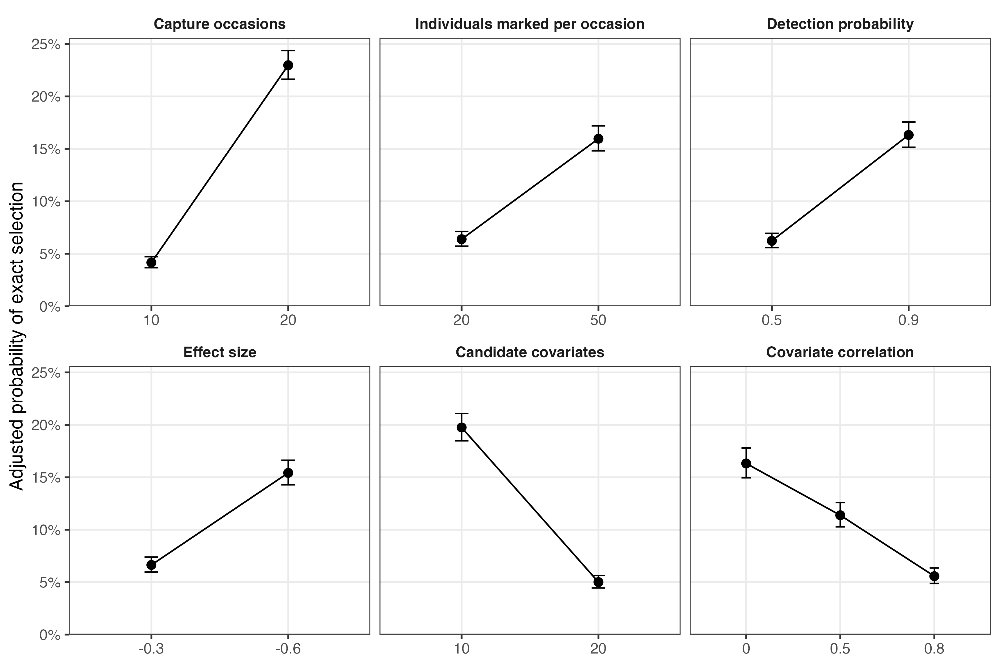

\small

^1^ CEFE, Univ Montpellier, CNRS, EPHE, IRD, Montpellier, France   

^2^ School of Information and Physical Sciences, College of Engineering, Science and Environment, University of Newcastle, Newcastle, Australia     

`*` Corresponding author: olivier.gimenez@cefe.cnrs.fr

\normalsize

\vspace{1cm}
\hrule

Explaining temporal variation in demographic parameters (e.g. survival, dispersal) is a central goal of capture--recapture (CR) studies, and the growing availability of environmental covariates -- e.g. from remote sensing -- means analysts increasingly face many, often correlated, candidate covariates. Standard covariate--selection tools become impractical as the number of candidates grows, since the number of candidate models increases combinatorially. We propose to use the Lasso, a penalized-likelihood approach that shrinks regression coefficients and sets unimportant ones to zero, to perform automatic covariate selection in CR models. We implement an adaptive Lasso applied to the likelihood of Cormack-Jolly-Seber (CJS) models, with the regularization parameter selected by BIC along a grid of penalty values. A simulation study spanning a range of sample sizes, detection probabilities, effect sizes, numbers of covariates and correlation structures shows that the Lasso blabla [PLACEHOLDER: summarise performances, including comparison with AIC]. We illustrate the approach with a 16-year CR dataset on white storks (*Ciconia ciconia*) breeding in France, in which survival is modelled as a function of rainfall at 10 weather stations in the wintering grounds (Sahel, West Africa). Because it operates directly on the likelihood, the approach extends naturally to CR models with several linked parameter sets, where combinatorial model selection is especially costly.

\vspace{3mm}
\hrule
\vspace{5mm}

*Keywords*: capture--recapture; covariate selection; Lasso; penalized likelihood; survival analysis; regularization

\newpage

```{r setup, include=FALSE, cache=FALSE, message = FALSE}
library("knitr")
opts_chunk$set(echo = FALSE, warning = TRUE, message = TRUE)
opts_chunk$set(tidy = TRUE, comment = NA, highlight = TRUE)
opts_chunk$set(fig.path = "output/figures/")
```

# Introduction

Explaining variation in demographic parameters such as survival or dispersal is a central objective of statistical ecology. Capture--recapture (CR) methods are the standard tool for this task: individuals are captured, marked and (imperfectly) re-observed over time, and demographic parameters are estimated while explicitly accounting for detection probability [@Lebreton1992]. To relate demographic paramters to environmental or individual covariates, CR modelling is typically framed as a form of (generalized linear) model, in which the temporal or individual variation in parameters is explained by one or several covariates on the logit scale [@Lebreton1992].

This regression-like framing runs into a practical difficulty as soon as the number of candidate covariates grows. This situation has become the norm rather than the exception with the increasing availability of environmental data from remote sensing and biologging. Analysts are then confronted with many, often correlated, candidate covariates, and typically do not know a priori which of them belong in the model. Including all of them inflates the number of parameters to estimate, which degrades precision and predictive performance; strong correlation among covariates further destabilizes numerical estimation [PLACEHOLDER: cite illustrative example].

Several strategies exist to select covariates in CR models. Analysts commonly reduce the covariate set a priori based on ecological reasoning and collinearity diagnostics, then compare a set of candidate models using information criteria such as AIC, or a stepwise procedure. Bayesian alternatives include DIC, stochastic search variable selection (SSVS) or reversible-jump MCMC (RJMCMC) [PLACEHOLDER: refs]. All of these approaches, however, require fitting and comparing a number of candidate models that grows combinatorially with the number of covariates ($2^K$ models for $K$ covariates), which quickly becomes impractical, and this number multiplies further in CR models with several linked parameter sets (survival, detection, transition) [PLACEHOLDER: needs to be better explained].

Here we explore an alternative route: instead of comparing discrete candidate models, we cast covariate selection as a continuous shrinkage problem. Penalized-likelihood methods add a penalty on the magnitude of regression coefficients to the likelihood being maximized; the Lasso [Least Absolute Shrinkage and Selection Operator] uses an $L_1$ penalty that has the property of setting some coefficient estimates exactly to zero, thereby performing covariate selection and shrinkage simultaneously, within a single model fit along a grid of penalty values. Penalized-likelihood approaches related to the Lasso have already been used in ecology, in particular for occupancy models and for species distribution models combining multiple data sources [PLACEHOLDER: develop a bit, with refs], but -- to our knowledge -- not yet for covariate selection in CR models, which is the gap we address here.

In this paper, we adapt the (adaptive) Lasso to the likelihood of Cormack--Jolly--Seber (CJS) CR models to perform automatic selection of covariates on survival. We describe the method, evaluate its performance through a simulation study spanning a range of sample sizes, detection probabilities, numbers of covariates and correlation structures, and illustrate it with a case study on the effect of Sahelian rainfall on the survival of white storks (*Ciconia ciconia*) breeding in France. We conclude with current limitations and extensions.

# Methods {#methods}

## Capture--recapture likelihood

Consider a CJS model for $n$ individually marked animals monitored over $T$ capture occasions. Let $\phi_t$ denote the probability that an individual alive just after occasion $t$ survives to occasion $t+1$, and $p_t$ the probability that an individual alive at occasion $t$ is detected. Survival is related to a set of $K$ covariates through a logit link,
$$
\text{logit}(\phi_t) = \mathbf{x}_t^\top \boldsymbol{\beta},
$$
where $\mathbf{x}_t$ is the covariate vector (including an intercept) associated with interval $t$ and $\boldsymbol{\beta} = (\beta_0, \beta_1, \ldots, \beta_K)^\top$ the corresponding regression coefficients; detection is modelled separately (e.g. constant, or with its own covariates). The CJS likelihood $L(\boldsymbol{\beta}, \boldsymbol{p} \mid \text{data})$ is formulated as a hidden Markov model conditional on first capture. The hidden states correspond to the alive and dead states, while the observations correspond to detection or non-detection. The likelihood is evaluated efficiently using the forward algorithm [PLACEHOLDER: (Pradel 2005)].

## Ridge regression and the Lasso

Ridge regression constrains the $L_2$ norm, $\sum_{j=1}^K \beta_j^2 \le c$, shrinking coefficients towards zero but rarely to exactly zero. The Lasso instead constrains the $L_1$ norm, $\sum_{j=1}^K |\beta_j| \le c$. Geometrically, the $L_1$ constraint region has sharp corners, so that the point where the likelihood contours first touch the constraint region often falls exactly on a corner or edge, setting the corresponding coefficient(s) to zero. This sparsity property makes the Lasso a method for simultaneous estimation and covariate selection (the intercept is left unpenalized).

It is convenient to rewrite the constrained optimization problem in its Lagrangian form. For a penalty parameter $\lambda \ge 0$, the adaptive Lasso estimator maximizes

$$
\ell(\boldsymbol{\beta}) -
\lambda \sum_{j=1}^{K} w_j |\beta_j|,
$$

where the adaptive weights are defined as

$$
w_j=\frac{1}{|\hat{\beta}^{\mathrm{MLE}}_j|^{\gamma}},
$$

with $\hat{\beta}^{\mathrm{MLE}}_j$ denoting the unpenalized maximum-likelihood estimate from the full model and $\gamma>0$ controlling the strength of the adaptation. Parameter $\gamma$ is usually set to 1. Covariates with larger unpenalized effects therefore receive a smaller penalty, whereas those with weaker effects are penalized more heavily. Under suitable regularity conditions, this adaptive weighting gives the estimator the oracle property, namely consistent identification of the nonzero coefficients together with asymptotically efficient estimation of their values [PLACEHOLDER: (Zou 2006)].

In our implementation, only the survival regression coefficients are penalized. The detection parameter and the intercept are left unpenalized.

## Choice of the regularization parameter

The amount of shrinkage is controlled by the regularization parameter $\lambda$. We evaluate a sequence of 150 values logarithmically spaced between $10^{-3}$ and $10^{2}$. For each value of $\lambda$, the penalized likelihood is maximized, yielding the corresponding adaptive Lasso estimate.

The retained model is selected by minimizing the Bayesian Information Criterion (BIC),

$$
\mathrm{BIC}(\lambda)
=
-2\,\ell(\hat{\boldsymbol{\beta}}_\lambda)
+
df_\lambda \log(n),
$$

where $\ell(\hat{\boldsymbol{\beta}}_\lambda)$ is the unpenalized log-likelihood evaluated at the adaptive Lasso estimates, $df_\lambda$ is the number of nonzero regression coefficients plus the unpenalized parameters, and $n$ is the effective sample size. Using the unpenalized likelihood ensures that models are compared on the same likelihood scale while model complexity is accounted for through the effective number of parameters. A coefficient is considered equal to zero whenever its absolute value is smaller than $10^{-3}$.

We prefer this grid-search/BIC strategy to $k$-fold cross-validation for two reasons. First, cross-validation requires refitting the entire regularization path for each fold, increasing the computational cost. Second, the value of $\lambda$ at which all penalized coefficients become zero generally differs across folds, making it difficult to define a common regularization path. Moreover, because our primary objective is covariate selection rather than prediction, information criteria such as the BIC provide a natural model selection criterion.

## Implementation

The CJS likelihood, the adaptive-Lasso path and the BIC-based selection are implemented in R [PLACEHOLDER: packages used]. Coefficients are considered zero below a small numerical tolerance ($10^{-3}$ here) rather than exactly zero, as is typical of penalized likelihoods maximized with general-purpose optimizers rather than coordinate-descent algorithms [PLACEHOLDER: acknowledge/discuss discrepancy with true coordinate-descent Lasso solutions].

# Simulation study {#simulations}

To evaluate the ability of the adaptive Lasso to identify the true survival covariates under a range of realistic capture--recapture settings, we conducted a factorial simulation study.

## Design

We simulated capture--recapture data under Cormack--Jolly--Seber models with either 10 or 20 capture occasions and either 10 or 20 newly marked individuals per occasion. Mean survival probability was fixed at $\bar{\phi}=0.8$, whereas detection probability took values of 0.5 or 0.9. Survival was modelled as a function of either 10 or 20 candidate covariates. In every scenario, only two covariates had a genuine effect on survival, with regression coefficients set to either $-0.3$ or $-0.6$ on the logit scale, while all remaining coefficients were equal to zero. This design allowed us to examine how covariate-selection performance changed as the number of candidate predictors increased while the number of truly informative predictors remained fixed. Covariates were generated either independently or with a pairwise correlation of 0.5 or 0.8, representing respectively favourable and challenging selection conditions.

The full factorial design comprised 96 scenarios. Each scenario was replicated 100 times, resulting in a total of 9600 simulated data sets. For each data set, the adaptive Lasso was fitted over 150 values of the regularization parameter $\lambda$, logarithmically spaced between $10^{-3}$ and $10^2$, and the final model was selected using the Bayesian Information Criterion.

## Performance metrics

We assessed performance using four complementary criteria. The primary performance metric was the exact selection probability, defined as the proportion of simulation replicates in which the adaptive Lasso recovered exactly the true set of informative covariates. This criterion reflects the ability of the method to identify the correct model without either missing relevant covariates or including spurious ones. To better understand the nature of selection errors, we also calculated sensitivity, corresponding to the proportion of truly informative covariates correctly retained, and specificity, corresponding to the proportion of non-informative covariates correctly excluded. High sensitivity indicates that the method successfully detects genuine effects, whereas high specificity reflects its ability to avoid false positives. Together, these measures help distinguish between under-selection (missing relevant covariates) and over-selection (retaining unnecessary covariates). We further recorded the average number of selected covariates to assess model parsimony. This metric complements sensitivity and specificity by indicating whether the adaptive Lasso tends to favour overly complex models despite good recovery of the true effects. Finally, we measured computation time to evaluate the computational cost of the procedure and its scalability as the number of candidate covariates increased.

## Results

The adaptive Lasso converged successfully for all simulated datasets. The probability of recovering the exact set of active covariates increased with the number of capture occasions, the number of individuals marked per occasion, detection probability, and covariate effect magnitude. Conversely, exact selection became less likely as the number of candidate covariates and the correlation among them increased (Fig. \@ref(fig:exact-selection)). These adjusted effects were estimated jointly, so the influence of each simulation factor was evaluated while averaging over the balanced levels of all remaining factors.

```{r exact-selection, out.width="100%", fig.align='center', fig.cap="Adjusted probability of exact model selection using adaptive Lasso with BIC. Points are estimated marginal probabilities from a binomial generalized linear model, adjusted for the other simulation factors; vertical bars are 95% confidence intervals.", eval=TRUE}

```

The adaptive Lasso tuned using BIC generally behaved conservatively. Specificity remained high across the simulation design, indicating that inactive covariates were rarely retained, whereas sensitivity was more strongly affected by the amount of information in the data (Fig. \@ref(fig:senspec)). Thus, under difficult sampling conditions, failures of exact model recovery were driven more often by omission of active covariates than by extensive inclusion of inactive covariates.

```{r senspec, out.width="100%", fig.align='center', fig.cap="Adjusted sensitivity and specificity of adaptive-Lasso selection using BIC. Estimates are marginal predictions from quasibinomial generalized linear models, adjusted for the other simulation factors; vertical bars are 95% confidence intervals.", eval=TRUE}
include_graphics("figure_sensitivity_specificity_adjusted.png")
```

```{r echo = FALSE, message = FALSE, warning = FALSE}
library(tidyverse)
library(emmeans)

bic_file <- "scenario_grid_results_BIC.csv"
aic_file <- "scenario_grid_results_AIC.csv"

read_results <- function(path, expected_criterion) {
  if (!file.exists(path)) stop("File not found: ", path)
  out <- read.csv(path, check.names = FALSE, stringsAsFactors = FALSE)

  required <- c(
    "scenario_id", "replicate", "n_occasions", "marked", "p",
    "effect_size", "n_covariates", "correlation", "exact_selection",
    "n_selected", "true_positives", "false_positives", "false_negatives",
    "true_negatives", "sensitivity", "specificity", "convergence"
  )
  absent <- setdiff(required, names(out))
  if (length(absent)) {
    stop(path, " is missing: ", paste(absent, collapse = ", "))
  }

  if ("criterion" %in% names(out)) {
    observed <- unique(toupper(as.character(out$criterion)))
    observed <- observed[!is.na(observed)]
    if (length(observed) && !all(observed == expected_criterion)) {
      warning(path, " contains criterion value(s): ", paste(observed, collapse = ", "),
              "; expected ", expected_criterion, ".")
    }
  }

  out %>%
    filter(is.na(convergence) | convergence == 0L) %>%
    mutate(
      occasions = factor(n_occasions, levels = c(10, 20)),
      individuals = factor(marked, levels = c(20, 50)),
      detectability = factor(p, levels = c(0.5, 0.9)),
      effect = factor(effect_size, levels = c(-0.3, -0.6)),
      candidates = factor(n_covariates, levels = c(10, 20)),
      correlation_factor = factor(correlation, levels = c(0, 0.5, 0.8))
    )
}

bic <- read_results(bic_file, "BIC")
aic <- read_results(aic_file, "AIC")
```

Across all simulation scenarios, BIC recovered the exact model in `r sprintf("%.1f", 100 * mean(bic$exact_selection, na.rm = TRUE))`% of datasets, with mean sensitivity `r sprintf("%.3f", mean(bic$sensitivity, na.rm = TRUE))`, mean specificity `r sprintf("%.3f", mean(bic$specificity, na.rm = TRUE))`, and a mean selected model size of `r sprintf("%.2f", mean(bic$n_selected, na.rm = TRUE))` covariates. The corresponding values under AIC were `r sprintf("%.1f", 100 * mean(aic$exact_selection, na.rm = TRUE))`%, `r sprintf("%.3f", mean(aic$sensitivity, na.rm = TRUE))`, `r sprintf("%.3f", mean(aic$specificity, na.rm = TRUE))`, and `r sprintf("%.2f", mean(aic$n_selected, na.rm = TRUE))`, respectively.

AIC therefore increased sensitivity relative to BIC but reduced specificity and selected larger models. Because the objective was identification of a parsimonious set of relevant covariates rather than maximization of predictive performance, BIC offered the more appropriate compromise between detecting active effects and limiting false discoveries.

# Case study: white stork survival and Sahelian rainfall {#case-study}

We illustrate the proposed methodology using a long-term capture--recapture study of white storks (*Ciconia ciconia*) breeding in France [PLACEHOLDER: study area and reference]. The data span 16 years and include more than 200 individually marked adults.

Most French white storks winter in the Sahel, where annual rainfall strongly influences primary productivity and food availability. Previous studies have therefore suggested that climatic conditions in the Sahel may affect annual adult survival. To investigate this hypothesis, we considered annual rainfall measured at ten meteorological stations distributed across the Sahel as candidate covariates for survival. Detection probability was modelled with an intercept only.

We fitted the full survival model including all ten rainfall covariates and computed the adaptive Lasso solution path over the regularization grid described above. The optimal model was selected using the Bayesian Information Criterion.

The BIC reached its minimum for a penalty value of approximately $\lambda = 8.4$ (Fig. \@ref(fig:bic-path)). The regularization parameter is shown on a logarithmic scale.

```{r bic-path, out.width="100%", fig.align='center', fig.cap="Bayesian Information Criterion as a function of the regularization parameter $\\lambda$ for the white stork survival model. The horizontal axis is displayed on a logarithmic scale. The vertical dashed line indicates the value of $\\lambda$ minimizing the BIC.", eval=TRUE}
include_graphics("bic_stork.png")
```

The coefficient paths (Fig. \@ref(fig:coef-path)) show the progressive
shrinkage of the rainfall effects as the penalty increases. The regularization
parameter is displayed on a logarithmic scale.

```{r coef-path, out.width="100%", fig.align='center', fig.cap="Regularization paths for the ten rainfall coefficients as a function of the penalty parameter $\\lambda$. The horizontal axis is displayed on a logarithmic scale. The vertical dashed line indicates the value of $\\lambda$ selected by the Bayesian Information Criterion.", eval=TRUE}
include_graphics("path_stork.png")
```

At the selected value of $\lambda$, only one rainfall covariate, corresponding to the meteorological station of Kita, retained a nonzero coefficient, whereas the remaining nine coefficients were shrunk to zero (Table \@ref(tab:coef-table)). The estimated effect of rainfall at Kita was positive, indicating higher apparent survival in wetter years. This result agrees with earlier analyses of these data, which identified the same geographical region as the main climatic driver of survival after reducing the rainfall variables by principal component analysis [PLACEHOLDER: reference].

```{r coef-table, echo=FALSE}
knitr::kable(
  data.frame(
    Parameter = c(
      "Survival intercept",
      "Diourbel",
      "Gao",
      "Kayes",
      "Kita",
      "Maradi",
      "Mopti",
      "Ouahigouya",
      "Segou",
      "Tahoua",
      "Tombouctou",
      "Detection intercept"
    ),
    Estimate = c(
      0.6755,
      0.0007,
      0.0003,
      0.0000,
      0.1757,
      -0.0002,
      0.0008,
      -0.0001,
      0.0001,
      0.0004,
      0.0000,
      2.3743
    ),
    Selected = c(
      "Yes",
      "No",
      "No",
      "No",
      "Yes",
      "No",
      "No",
      "No",
      "No",
      "No",
      "No",
      "Yes"
    )
  ),
  digits = 4,
  booktabs = TRUE,
  caption = "Adaptive Lasso estimates for the white stork case study. Only the rainfall covariate corresponding to the Kita meteorological station was retained by the BIC-selected model."
)
```

# Discussion {#discussion}

We have shown that the (adaptive) Lasso, applied directly to the CJS likelihood, provides an effective alternative to information-criterion-based or Bayesian variable-selection procedures for covariate selection in CR survival models. [PLACEHOLDER: develop a bit]. 

A key advantage of working directly at the likelihood level is that the approach generalizes readily to CR models with several linked sets of parameters -- for instance multistate models (survival, detection, transition probabilities) or multievent models with additional latent-state parameters -- where combinatorial model selection across parameter sets is particularly cumbersome (which set of covariates to test first, and in which order?). The Lasso sidesteps this question entirely by penalizing all parameter sets jointly within a single model fit. Modifying existing CR software to implement a penalized likelihood is comparatively straightforward, which suggests the approach could in time be incorporated into standard CR platforms (e.g. MARK, `unmarked`, E-SURGE).

Several limitations remain. First, our current implementation does not provide confidence intervals or significance tests for the selected coefficients; the bootstrap is a natural solution but increases computation time substantially, and its performance under adaptive-Lasso shrinkage remains to be characterized. Second, we focused on continuous, purely temporal covariates; when covariates are categorical (e.g. age class or discrete time effects), one is often not interested in the effect of a single level but in the effect of the *factor as a whole*, which the plain Lasso does not handle naturally -- the group Lasso, which penalizes and selects groups of coefficients jointly, is a natural extension we are currently exploring. Third, our optimizer (`optim()`) yields coefficients that are shrunk close to, but not always exactly at, zero, unlike coordinate-descent algorithms designed specifically for the Lasso; a numerical zero-tolerance threshold is used here as a practical workaround, but implementing a dedicated descent algorithm (requiring the CJS score equations) would be a cleaner long-term solution [PLACEHOLDER: decide whether to keep this as a stated limitation or to actually implement it before submission].

Finally, penalized-likelihood approaches related to the Lasso already exist for occupancy models, and we see an opportunity to connect that literature with the CR setting explored here, including a Bayesian formulation of the shrinkage prior underlying the Lasso [PLACEHOLDER: shall we mention the double Laplace?].

# Acknowledgments

[PLACEHOLDER: Folks Euring and ISEC conferences]

## Data availability statement

[PLACEHOLDER: per JSE guidelines, code and data (or a fully reproducible simulated look-alike dataset) must be archived, e.g. on GitHub/Zenodo, with an anonymized link at submission for double-blind review -- see https://anonymous.4open.science/.]

## Funding statement

[PLACEHOLDER: Ian, maybe the grant you got for your sabbatical visits in France?]

# References

::: {#refs}
:::

\clearpage

\newpage
